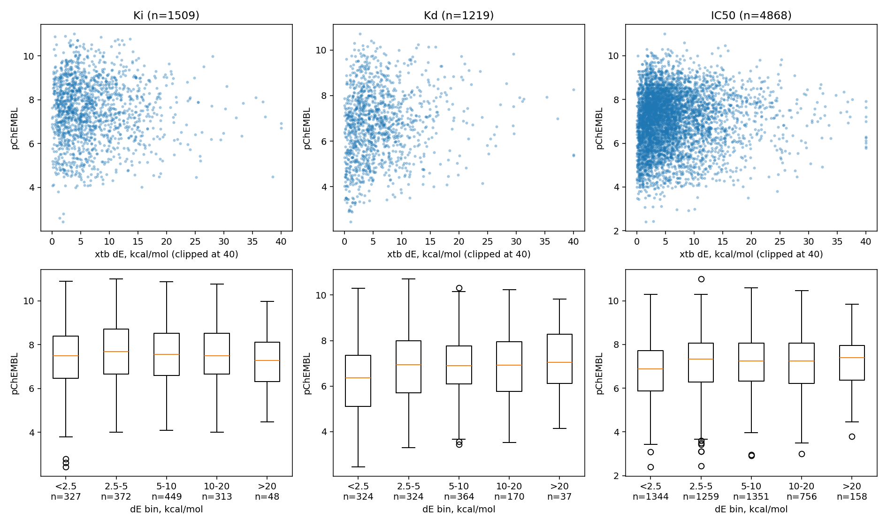

# PDB Ligand Survey

A survey of small organic ligands in X-ray protein complexes from the PDB, in 2D (chemistry) and 3D (binding mode, strain), split by protein family and resolution class, with an interactive Streamlit/Bokeh explorer.

## Scope

- Source: X-ray structures with resolution < 5 Å that contain a protein and a non-polymeric ligand.
- Ligand size: 200 < MW < 2000. Crystallisation agents, buffers and ions are excluded.
- Per ligand instance the pipeline computes:
  1. 2D descriptors (MW, logP, TPSA, HBD/HBA, rotatable bonds, rings, Fsp3, stereocentres, ...).
  2. Buried fraction and number of rotatable bonds in the buried part of the ligand.
  3. A semi-empirical (GFN2-xTB) strain energy: ΔE of the deposited pose versus the lowest-energy minimised 3D structure.
- Explorer: UMAP maps coloured by rotatable bonds, buried fraction, protein family, resolution class or ΔE, with hover structure images, and filters by resolution class (high < 2 Å, medium 2–3.5 Å, low 3.5–5 Å).

## Final dataset (`data/survey.parquet`)

| | |
|---|---|
| Ligand instances | 206,444 |
| Unique ligands (CCD components) | 34,551 |
| PDB entries | 77,448 |
| Resolution classes (instances) | high 72,425; medium 128,852; low 5,167 |
| Median buried fraction | 0.82 |
| Median rotatable bonds (all / buried part) | 6 / 5 |
| Median MW | 381 |
| Instances with strain energy | 24,346 (one representative instance per unique ligand) |

Instances per family: Other 57,599; Oxidoreductase 30,163; Other enzyme 21,573; Synthase/Lyase 16,483; Transferase 15,718; Kinase 15,218; GPCR 12,743; Protease 11,824; Hydrolase 11,000; Chaperone/Binding 5,025; Nuclear receptor 3,027; Phosphodiesterase 2,335; Transporter 2,014; CYP 1,156; Ion channel 566.

Filters applied (the instance counts above are after all of them):
- Buried fraction < 0.3 removed.
- No metals at all: ligands that contain a metal or touch one (< 2.8 Å) are dropped in `04_merge.py`. Use `--keep-metals` to keep them.
- Ligands with up to 10% unresolved template atoms are accepted. Their geometry comes from the atoms present, so burial and buried rotatable bonds are lower bounds (`n_missing`, `frac_missing`).
- Strain-eligible ligands are also drug-like (MW 200–700, logP −3..6, HBD ≤ 6, HBA ≤ 12, TPSA ≤ 200, ≤ 15 rotatable bonds, ≥ 1 ring), non-covalent, ≤ 60 heavy atoms and fully resolved.

## Pipeline

Run in order from this folder. Data go to `data/` (override with the `SURVEY_DATA` environment variable).

| Step | Script | What it does |
|---|---|---|
| 1 | `01_select.py` | RCSB Search API v2 plus GraphQL: X-ray, resolution < 5 Å, protein + non-polymer. Writes `instances.parquet` (one row per ligand instance, with RSCC, resolution, class) and `chains.parquet` (descriptions, UniProt, keyword-based family). Built-in crystallisation-agent and ion list in `agents.py` (`--agents-file` adds more). |
| 2 | `02_components.py` | Per unique CCD id: SMILES and 2D descriptors (`components.parquet`). Downloads the CCD ligand cif for bond orders, charges and atom names. |
| 3 | `03_instances.py` | Per-instance 3D features from the mmCIF (gemmi): own Shrake–Rupley SASA (probe 1.4 Å), contacts, covalent and metal-contact flags, buried rotatable bonds. Resumable chunks (`data/parts/`). `--redo` recovers instances missing from the first pass and applies `--max-missing 0.10`. |
| 4 | `04_merge.py` | Merges everything (and `strain.parquet`) into `survey.parquet/.csv`; applies the metal filter. |
| 5 | `05_umap.py` | UMAP embeddings: chemistry (Morgan fingerprint, Jaccard, per unique ligand) and descriptors (scaled, per instance). Re-run whenever the instance set changes. |
| 6 | `06_strain.py` | xtb strain energy (below). |
| 7 | `07_orca_validate.py` | DFT validation of the xtb ΔE with ORCA single points on a 150-ligand sample (below). |
| 8 | `08_potency.py` | Links strain ligands to ChEMBL 37 binding-assay potencies and tests potency against strain (below). |
| 9 | `09_cofactors.py` | Strain of natural nucleotide ligands and cofactors and its relation to BRENDA Km, kept separate in `data/cofactors/` (below). |
| 10 | `10_strain_terms.py` | Splits the strain into MMFF94 energy terms (torsion, angles + bonds, van der Waals, electrostatics) on a 1,000-ligand sample (below). |
| – | `app.py`, `molserver.py` | `streamlit run app.py`. `molserver.py` is a small localhost server that draws RDKit SVGs for the hover images. |
| – | `family.py`, `common.py`, `outliers.py` | Family keywords; shared helpers (paths, CCD to RDKit, SASA); draws ligands above a ΔE threshold to `data/strain_outliers.png/.csv`. |

Typical full run:

```powershell
python 01_select.py
python 02_components.py
python 03_instances.py
python 03_instances.py --redo
python 04_merge.py
python 05_umap.py
python 06_strain.py --workers 12
python 04_merge.py
streamlit run app.py
```

Requirements: Python with RDKit, gemmi, numpy, scipy, pandas, pyarrow, umap-learn, tqdm, Streamlit 1.40.1 and Bokeh 3.10.1; xtb 6.7.1 (path via `XTB_EXE`). ORCA 5.0.2 (`C:\ORCA`) for step 7 only.

## Definitions

- **Buried fraction**: 1 − SASA(complex) / SASA(free ligand). This approximates buried volume; symmetry mates are ignored.
- **Buried atom**: per-atom burial ≥ 0.5. **Buried rotatable bond**: Lipinski-strict rotatable bond with both atoms buried.
- **Altlocs**: the lowest altloc per residue is used.
- **Family**: keyword match on PDB entity descriptions (see caveats).

## Strain energy (`06_strain.py`)

GFN2-xTB with ALPB implicit water, one thread per job.

1. **E_pose**: the deposited pose. Every non-terminal heavy-atom bond is held by a harmonic dihedral constraint (force constant 0.5, torsions stay within ~2°); bonds, angles and hydrogens relax. An earlier version froze all heavy atoms, which also froze X-ray bond errors and added 16–20 kcal/mol of noise.
2. **E_relax**: unconstrained relaxation starting from the pose.
3. **E_ref**: the lowest of an ETKDGv3 conformer ensemble (≤ 60 conformers, MMFF/UFF pre-filter, 0.5 Å RMSD pruning, 8 lowest xtb-optimised) and E_relax. Cached per ligand (sha1 of SMILES, charge and settings) in `data/strain_ref/`.
4. **`delta_e_kcal`** = E_pose − E_ref (the survey's ΔE). **`local_strain_kcal`** = E_pose − E_relax (strain in the pose's own basin). 1 Eh = 627.5095 kcal/mol.

**Ionisation (default on)**: CCD ligands are neutral, but neutral acids fold into internally H-bonded conformers in the reference ensemble and inflate ΔE. A rule-based pH 7 model is applied: carboxylic and sulfonic acids become anions, phosphates and phosphonates up to dianions, amidines and guanidines cations. Aliphatic amines are not protonated by default (`--ionize-amines`), because that raised ΔE for 6 of 8 outliers tested. Examples: 4AYY 46 → 13.6 kcal/mol; 6U7A 38.5 → 27.3.

**Statuses**: `ok`, `xtb_pose_failed`, `unsupported_element` (Li, Be, Na, Mg, Al, K, Ca and elements heavier than Br), `open_shell`, `too_large`, `incomplete`, `no_reference`, `entry_error`.

**Geometry QC columns (`qc_*`)** compare the X-ray pose with the constrained xtb geometry: RMSD, number of bonds > 0.08 Å and angles > 10° off, aromatic non-planarity, CCD stereo mismatch (RDKit CIP labeler), minimum contact, non-polar clashes < 3.0 Å. `qc_pass` is true when there are < 3 bond deviations, RMSD ≤ 0.5 Å, minimum contact ≥ 2.0 Å and no stereo mismatch. See the validation limits below.

Full-run command and cost:

```powershell
python 06_strain.py --workers 12
```

The run is resumable. Options: `--scope unique|all`, `--sample N`, `--max-heavy`, `--min-buried`, `--no-druglike`, `--no-ionize`, `--ionize-amines`, `--n-opt`, `--max-confs`.

## Strain results

Final run: 24,799 unique ligands attempted, **24,346 ok (98.2%)**. Failures: 230 unsupported element, 193 xtb pose failures, 17 open-shell, 13 RDKit valence errors (mostly boron). Mean 75 CPU-s per ligand (median 43 s), about 517 CPU-hours in total.

| ΔE (kcal/mol) | Value |
|---|---|
| Median | 5.30 |
| Mean | 7.36 |
| Interquartile range | 2.64 – 9.67 |
| Maximum | 153.2 |
| ≤ 5 / 5–10 / 10–20 / > 20 | 11,552 / 7,003 / 4,487 / 1,304 ligands |
| > 30 / > 50 | 376 / 81 ligands |

Local strain (E_pose − E_relax): median 3.41, mean 5.24.

**By resolution class** (median / 75th percentile ΔE): high (n = 12,795) 4.67 / 8.40; medium (n = 11,403) 6.08 / 10.92; low (n = 148) 9.95 / 16.07. Strain rises as resolution worsens, as expected if part of ΔE is coordinate error.

**By rotatable bonds** (median ΔE): 0–2: 2.35; 3–5: 4.14; 6–8: 6.53; 9–15: 10.77.

**By family** (median ΔE, families with n ≥ 700): Chaperone/Binding 4.03; Oxidoreductase 4.43; Kinase 4.44; Phosphodiesterase 4.64; Other 5.22; GPCR 5.69; Protease 5.88; Other enzyme 6.00; Synthase/Lyase 6.28; Nuclear receptor 6.45; Transferase 6.52. Differences between families are about 2 kcal/mol and partly follow ligand size and flexibility, so compare within similar rotatable-bond classes.

**Correlation with ΔE (Spearman)**: rotatable bonds 0.48, MW 0.41, heavy atoms 0.40, buried rotatable bonds 0.35, resolution 0.17, RSCC −0.14, buried fraction −0.10.

**QC split**: 17,985 ligands pass and 6,361 fail. Median ΔE is 4.82 for passing and 7.19 for failing; the 90th percentile is 13.4 versus 21.4.

### Outlier analysis (pilot and follow-ups)

- A 2,000-ligand pilot showed a long tail (37 ligands > 30 kcal/mol). Ionisation fixed 7 of those 37.
- Of 15 outliers that persisted after ionisation, about 8 look like modelling errors: a chirality mismatch against the CCD (1S3V), a 1.30 Å contact plus a bond 0.31 Å off (3EP6), a 0.89 Å RMSD with 7 angles off (1A6V), 7 bonds off (9XU9), a non-planar aromatic ring (4EL0), close contacts (5ICK) and others. About 7 look plausibly real or unclear (for example 6ULA, 6KOT, 3LCO, 7R3C, 4CJ3, 5SC6, and macrocycle 7U98).
- Real-pose strain cannot be separated from error with these descriptors alone. **RSCC does not detect the outliers**: 10 of the 15 have RSCC 0.9–1.0.
- Random 200-ligand test, ionised versus neutral: 162 identical, 38 changed (35 anions, 3 cations). Median ΔE of the changed group fell from 9.9 to 5.8; overall median 5.53 to 5.31.
- Test of the QC flag on 15 persistent outliers plus 30 typical ligands: it flagged 6 of 15 outliers and wrongly flagged 6 of 30 typical ligands (AUC about 0.72–0.75 for RMSD or bond count). Ring planarity and clash counts were not predictive. Treat `qc_pass` as a diagnostic, not a validated filter. The app checkbox is off by default.

## DFT validation (`07_orca_validate.py`)

Checks whether the xtb ΔE ranks ligands like DFT does. The geometries stay the same and only the energy method changes.

1. **`prep`**: samples 150 ligands from `strain.parquet`, stratified over the ΔE bins (< 5, 5–10, 10–20, > 20 kcal/mol; the tail is over-represented), with ≤ 35 heavy atoms and |charge| ≤ 1. It re-creates the xtb geometries (torsion-constrained pose, relaxed pose and the 2 lowest ensemble conformers) in `data/orca/<pdb>_<comp>_<asym>/` and writes `manifest.csv` and `xtb_energies.json`.
2. **`run`**: ORCA 5.0.2 single points, r2SCAN-3c with CPCM(water) and TightSCF, on every geometry (about 600). Resumable through `data/orca/results.jsonl`. MPI is not installed on this machine, so run many 1-process jobs in parallel.
3. **`analyse`**: DFT ΔE = E_pose − min(E_relax, E_conf1, E_conf2), compared with the xtb ΔE on the same candidates and with the production `delta_e_kcal`. Reports Pearson/Spearman, MAE, bias, fit slope, triage-bin agreement and the same comparison for local strain, and writes `validation.csv` and `validation.png`.

```powershell
python 07_orca_validate.py prep --n 150 --workers 8
python 07_orca_validate.py run --jobs 16 --nprocs 1
python 07_orca_validate.py analyse
```

Estimated cost: about 80–100 CPU-hours (roughly 5–6 h on 16 parallel jobs).

### Results (150 ligands, r2SCAN-3c/CPCM(water) on xtb geometries)

| Comparison (kcal/mol) | Pearson | Spearman | MAE | Bias (DFT − xtb) | RMSE | Fit |
|---|---|---|---|---|---|---|
| ΔE, xtb vs DFT | 0.91 | 0.88 | 3.52 | −2.15 | 5.05 | DFT = 0.97·xtb − 1.83 |
| Local strain, xtb vs DFT | 0.91 | 0.88 | 2.55 | −1.53 | 3.99 | DFT = 0.94·xtb − 0.98 |


- The xtb ΔE reproduces the production `delta_e_kcal` exactly (same seed and ensemble), so the production values are validated directly.
- **Ranking agrees well; absolute values are about 2 kcal/mol too high in xtb.** The slope is close to 1, so the difference is an offset, not a scale error. Median ΔE is 9.9 (xtb) versus 6.9 (DFT) on this tail-enriched sample.
- By xtb ΔE bin (median xtb → DFT; mean bias): < 5: 2.8 → 1.2 (−0.9); 5–10: 6.8 → 4.6 (−1.7); 10–20: 13.6 → 10.0 (−3.7); > 20: 25.2 → 24.4 (−2.3). Overall bias is larger for charged ligands (−4.4, n = 32) than neutral ones (−1.6).
- Triage-bin agreement is 61%. Of the 59 disagreements, 50 put the ligand in a lower bin in DFT and 9 in a higher bin. Most are one bin apart: 22 of the 37 ligands that xtb puts at 5–10 are < 5 in DFT. Six differ by more than one bin, all with xtb higher (5 ligands from 10–20 to < 5, 1 from > 20 to < 5). Of the 37 ligands with xtb ΔE > 20, 26 are also > 20 in DFT, 10 are 10–20 and 1 is < 5.
- The two methods choose a different lowest reference conformer in 61% of ligands, which is expected, and it lowers DFT ΔE relative to xtb. Six ligands have a slightly negative DFT ΔE (down to −2.5 kcal/mol), meaning the deposited pose is lower than all three DFT reference candidates.
- Largest disagreements: xtb too high by 20 kcal/mol (9UDO/A1L81: 30.7 → 11.0) and by 18.7 (4E8Z/IHC: 21.7 → 3.0); xtb too low by 15 (4RC3/3OA: 28.6 → 43.4) and by 10 (7EGV/J3L: 38.1 → 48.1).
- Only 32 charged ligands and 150 in total were tested, and the sample is enriched for high ΔE, so the numbers describe the tail more than the typical ligand.

**Reading the survey values:** use xtb ΔE for ranking and triage (< 5 / 5–10 / 10–20 / > 20), and expect true DFT-level strain to be about 2 kcal/mol lower on average, 4 kcal/mol for charged ligands. A ΔE above 20 kcal/mol in xtb stays above 10 in DFT for 36 of 37 tested ligands (26 stay above 20), so the high-strain tail is real at DFT level, but the 5–10 and 10–20 bins are the least reliable (about 60% and 45% of them fall into a lower bin in DFT).

Limits of this test: DFT single points are on xtb geometries (no DFT re-optimisation), and the DFT reference is the lowest of only 3 candidates (relaxed pose plus 2 xtb conformers). A more complete conformer search can only lower the reference energy, so the DFT ΔE here is a lower bound and the true bias may be smaller. One functional (r2SCAN-3c) was used.

## Potency versus strain (`08_potency.py`)

Question: do ligands that bind in a more strained conformation bind less potently?

```powershell
python 08_potency.py
```

`python 08_potency.py analyse` repeats the statistics without querying the database again. The ChEMBL 37 SQLite file is opened read-only (path via `CHEMBL_DB`).

**Linking rules**
- Compound: InChIKey from the CCD ligand file, searched on the connectivity block, salt and parent forms included. The stereo block must match; the protonation character is ignored.
- Assay: binding (`assay_type = B`), confidence score 8–9, single-protein target, wild type, `standard_relation = '='`, pChEMBL present, no data-validity comment, not a potential duplicate; Ki, Kd, IC50 or Km.
- Protein: the PDB entry used for the strain calculation must have the assay target's UniProt accession.
- One value per ligand, target and type: the median pChEMBL.

Result: 7,596 ligand–target values, 6,289 ligands, 797 targets. No Km values qualified (none of the matched Km entries had a pChEMBL).

### Results (Spearman correlation of pChEMBL with ΔE)

| | Ki | Kd | IC50 |
|---|---|---|---|
| Values / targets | 1,509 / 321 | 1,219 / 350 | 4,868 / 665 |
| Raw | 0.00 | +0.15 | +0.10 |
| Partial (heavy atoms, rotatable bonds, resolution) | −0.13 | −0.05 | −0.10 |
| 95% interval of partial (targets resampled) | −0.21 to −0.06 | −0.11 to +0.01 | −0.13 to −0.06 |
| Partial, resolution ≤ 2.5 Å and `qc_pass` | −0.17 | −0.07 | −0.10 |
| Within-target weighted mean, partial (heavy atoms, rotatable bonds); targets with ≥ 15 ligands | 0.01 (21) | −0.11 (9) | −0.07 (91) |
| Raw correlation with heavy atoms (for comparison) | +0.34 | +0.41 | +0.39 |



**Conclusions**
- Strain is a very weak predictor of potency across ligands. Ligand size is far stronger, and because larger ligands are both more potent and more strained, it hides the small negative relation in the raw numbers.
- At equal size and flexibility, more strain goes with slightly lower Ki and IC50 (under 2% of rank variance; about 3% for Ki in the quality subset). For Kd the interval includes zero.
- Within targets the average relation is near zero for Ki and small for Kd and IC50; intervals were not computed for these.
- High strain does not exclude high potency: 25–29% of ligands above 20 kcal/mol have pChEMBL ≥ 8.
- The correlation of ligand efficiency with ΔE (−0.35 to −0.40) should not be read as a strain effect: ligand efficiency divides by heavy atoms and ΔE grows with them.

**Limits**: one structure and one ΔE per ligand; xtb ΔE has an error of about 3.5 kcal/mol (MAE against DFT); assay conditions differ between laboratories, especially for IC50; crystallised ligands lean towards potent ones; associations only, no causal claim.

Outputs in `data/potency/`: `activities.parquet`, `pairs.csv`, `stats.txt`, `per_target_<type>.csv`, `potency_vs_strain.png`.

## Cofactor strain versus Km (`09_cofactors.py`)

Question: how strained are the natural nucleotide ligands and cofactors when bound, and does the strain relate to the substrate Km? All outputs are kept apart from the survey in `data/cofactors/`; `strain.parquet` and `survey.parquet` are not touched.

```powershell
python 09_cofactors.py run --workers 12
python 09_cofactors.py brenda
python 09_cofactors.py analyse
python 09_cofactors.py analyse --km data/cofactors/km_brenda_ecorg.csv
```

Also: `select` shows what would be run, `km` extracts ChEMBL Km values (47 only, too sparse to use).

**Method**
- Ligands (CCD ids): ATP, ADP, AMP, CMP (cAMP), NAD, NAI (NADH), NAP (NADP+), NDP (NADPH), FAD, FDA (FADH2), FMN.
- Instances: resolution ≤ 2.5 Å, buried fraction ≥ 0.3, complete, non-covalent, with a UniProt accession, up to 3 per ligand and protein (`--per`). The drug-like and metal filters of the survey are not applied: metal-contacting instances (20%) are kept and flagged, and **the metal is left out of the energy**.
- Energies: the protocol of `06_strain.py`, with one larger reference ensemble per ligand (up to 300 conformers, 30 optimised with xtb) starting from the CCD ideal coordinates. The analysis uses one common reference per ligand and charge: the lowest energy of the ensemble or of any relaxation.
- Km: BRENDA 2026.1 JSON download (`data/cofactors/brenda/json/`), mutant enzymes and ranges skipped (5,329 mutant entries). pKm = −log10(Km in mol/L), median per ligand and protein. Two tables, analysed separately: `km_brenda.csv` (same UniProt accession; 243 ligand–protein pairs, 416 values) and `km_brenda_ecorg.csv` (BRENDA entries without accession, same EC number and organism; 93 pairs, 349 values).

### Strain of bound cofactors

6,872 instances run, 6,851 ok (21 xtb pose failures). 57 with stereochemistry differing from the CCD are excluded, leaving 6,794 instances and 4,470 ligand–protein pairs. About 118 job-hours for the instances (mean 62 s), reference ensembles not counted.

| Ligand | Instances | Proteins | ΔE median (kcal/mol) | Interquartile range | Local strain median | SD within / between proteins |
|---|---|---|---|---|---|---|
| ADP | 1,236 | 832 | 20.4 | 17.1 – 23.6 | 10.9 | 9.0 / 5.7 |
| AMP | 507 | 384 | 14.0 | 11.4 – 16.8 | 8.2 | 2.6 / 4.4 |
| ATP | 694 | 489 | 28.2 | 24.4 – 31.9 | 15.8 | 3.9 / 5.9 |
| CMP | 63 | 48 | 3.0 | 2.1 – 4.2 | 2.3 | 3.4 / 3.8 |
| FAD | 1,123 | 645 | 39.6 | 36.4 – 43.2 | 14.0 | 6.6 / 6.6 |
| FDA | 58 | 40 | 33.0 | 29.5 – 36.6 | 17.9 | 2.8 / 6.6 |
| FMN | 620 | 385 | 25.1 | 21.3 – 28.4 | 5.2 | 2.7 / 4.9 |
| NAD | 1,071 | 702 | 35.9 | 32.0 – 39.9 | 21.2 | 4.7 / 8.8 |
| NAI | 201 | 142 | 30.0 | 27.7 – 33.0 | 15.4 | 2.9 / 4.5 |
| NAP | 797 | 518 | 46.8 | 41.6 – 51.6 | 25.6 | 4.8 / 7.8 |
| NDP | 424 | 283 | 43.2 | 38.7 – 49.3 | 21.8 | 4.8 / 6.9 |

- **These ΔE values are not binding penalties.** The molecules are highly charged and fold up in implicit solvent without the protein or metal ion, and ΔE grows with charge and size. Compare values only within one ligand. The DFT check above did not include ligands this highly charged.
- "SD within" is pooled over proteins with more than one structure; "between" is the SD of the per-protein median. For ADP the within-protein spread is larger than the between-protein spread, and for FAD equal.
- Local strain (E_pose − E_relax) is missing for 640 of the 6,851 successful instances.
- Metal contact changes the median ΔE of most ligands by 4 kcal/mol or less (NDP: 43.2 without, 51.9 with); this does not show the effect of the metal on the energy, which is not computed.

### Strain versus Km

Spearman correlation of pKm with strain, 95% bootstrap interval. Higher pKm means lower Km.

| Set | n (ΔE) | pKm vs ΔE | pKm vs local strain |
|---|---|---|---|
| All ligands, UniProt table | 240 | +0.06 [−0.06, +0.19] | −0.10 [−0.24, +0.03] |
| All ligands, EC + organism table | 93 | +0.22 [+0.01, +0.42] | +0.07 [−0.15, +0.29] |
| Ranked within ligand, UniProt table (ligands with ≥ 10 pairs) | 229 | −0.06 [−0.18, +0.07] | −0.09 [−0.22, +0.04] |
| Ranked within ligand, EC + organism table | 74 | −0.10 [−0.34, +0.14] | −0.33 [−0.53, −0.10] |
| Same, without ATP | 50 | +0.05 [−0.25, +0.36] | −0.15 [−0.43, +0.14] |

Local-strain rows have fewer pairs where relaxation values are missing. ADP, NAD, NADH, NADP+ and NADPH show no clear relation in any table where they have at least 10 pairs; AMP, cAMP, FAD, FADH2 and FMN have too few. Buried fraction showed no clear relation either.

**One lead: ATP in kinases.** More local strain goes with a higher Km.

| ATP set | n | pKm vs local strain | pKm vs ΔE |
|---|---|---|---|
| All, UniProt table | 48 | −0.29 [−0.54, −0.02] | −0.27 [−0.54, +0.01] |
| All, EC + organism table | 24 | −0.68 [−0.87, −0.32] | −0.42 [−0.72, −0.02] |
| Non-kinases, UniProt table | 28 | −0.02 [−0.39, +0.34] | −0.07 [−0.44, +0.29] |
| Kinases, UniProt table | 20 | −0.68 [−0.87, −0.27] | −0.54 [−0.81, −0.12] |
| Kinases, both tables, one per protein | 37 | −0.71 [−0.85, −0.47] | |
| Protein kinases only | 19 | −0.64 [−0.87, −0.19] | −0.14 [−0.58, +0.41] |
| Other kinases only | 18 | −0.44 [−0.84, +0.12] | −0.27 [−0.70, +0.23] |

**Conclusion**: Km shows no general relation with cofactor strain. The ATP–kinase result is a hypothesis, not a finding:
- It was found after looking at many ligand, measure and subgroup combinations, with no correction for multiple testing.
- The EC + organism table gives one Km value to several proteins (15 distinct values for 24 ATP rows). Restricted to values assigned to a single protein it is still −0.75, on 12 rows.
- Small-molecule kinases show more local strain (median 18.6 vs 11.3 kcal/mol) and somewhat higher Km than protein kinases (protein or small-molecule type assigned by hand). The trend within protein kinases argues against this being the whole explanation.
- In the all-ATP UniProt set, adjusting for resolution, burial and metal contact widens the interval to include zero (−0.26 [−0.53, +0.04]); in the pooled kinase set it does not change the result (−0.72).
- The family labels have errors (EGFR, MET and the insulin receptor are labelled GPCR and so are missing from the kinase subsets).

A proper test needs ATP kinases outside this set, Km measured on the crystallised construct under comparable assay conditions, and the prediction fixed in advance.

**Limits**: crystal and assay conditions (pH, temperature, co-substrate, Mg²⁺) are not matched; a bound ligand may be a product or inhibitory state rather than the substrate complex; Km is not a binding constant; independent reference ensembles of one ligand differed by up to about 5 kcal/mol in a pilot. Within one UniProt-matched ligand–protein pair, BRENDA values scatter with a median SD of 0.19 log10 units (89 pairs with more than one value).

Outputs in `data/cofactors/`: `strain.parquet`, `instances_strain.csv`, `protein_strain.csv`, `km_*.csv`, `km_vs_strain_<table>.csv`, `stats_<table>.txt`, and the subgroup checks `km_robustness.py` / `km_robustness.txt`.

## Energy-term split of the strain (`10_strain_terms.py`)

Question: is the strain of bound ligands mainly torsional, compared with van der Waals contacts, bond angles or electrostatics? xtb gives no such split, so MMFF94 (RDKit) energy terms are evaluated on re-created xtb geometries.

```powershell
python 10_strain_terms.py run --n 1000 --workers 12
python 10_strain_terms.py analyse --eps 1
python data/terms/terms_check.py > data/terms/terms_check.txt
python 10_strain_terms.py analyse --eps 4
```

Each `analyse` overwrites `terms_held.csv`, `stats_held.txt` and `terms_held.png`; rename the report before the next one. `terms_check.py` needs the `--eps 1` table, so run it before the `--eps 4` analysis.

**Method**
- Random sample (fixed seed) of ligands with strain status `ok`, skipping those that took more than 900 s in step 6. The pose, relaxed and reference geometries are re-created with the step 6 protocol and saved in `data/terms/geoms/`.
- "Held" geometry (default): each structure is first minimised with MMFF94, torsions restrained, so that bond and angle differences between the two force fields do not dominate. The torsion drift was small (median per-ligand maximum 0.5°). `--geometry raw` evaluates the xtb geometries directly.
- Terms: torsion; angles + bonds (bond, angle, stretch–bend, out-of-plane); intramolecular van der Waals; electrostatics, divided by a dielectric constant `--eps`.

**Results** (1,000 sampled, 993 analysed; 4 without MMFF94 parameters, 3 failed xtb relaxations). The re-created ΔE matched step 6 (median absolute difference 0.000 kcal/mol, none differing by more than 1).

First check how well the MMFF94 sum reproduces xtb (Spearman):

| MMFF94 sum vs xtb | eps 1 | eps 4 | eps 80 |
|---|---|---|---|
| ΔE (pose − reference), held | 0.74 | 0.64 | 0.52 |
| ΔE, raw geometry | 0.64 | 0.48 | not run |
| Local strain (pose − relaxed), held | 0.71 | 0.66 | not run |

eps 1 is used as the main result because it agrees best. It was chosen on that agreement, not on physical grounds.

Share of the xtb ΔE variance in ranks explained by each term at eps 1 (Shapley split, which divides overlap between terms fairly; 95% bootstrap intervals):

| Term | All (993) | Given rotatable bonds, atoms, charge, resolution | Neutral (789) | Charged (204) | Median term difference (kcal/mol) |
|---|---|---|---|---|---|
| Torsion | 0.19 [0.15, 0.23] | 0.11 [0.09, 0.14] | 0.24 | 0.08 | 1.96 |
| Electrostatics | 0.20 [0.15, 0.24] | 0.09 [0.07, 0.13] | 0.17 | 0.30 | 2.07 |
| Van der Waals | 0.05 [0.03, 0.07] | 0.02 [0.01, 0.04] | 0.05 | 0.06 | 0.08 |
| Angles + bonds | 0.04 [0.02, 0.06] | 0.03 [0.01, 0.04] | 0.06 | 0.00 | −0.02 |
| All four terms | 0.47 | 0.25 (covariates alone: 0.32) | 0.52 | 0.43 | |

- **Torsion and electrostatics** are the two main terms, well ahead of van der Waals and angles + bonds. In ranks they tie (95% interval of the difference −0.07 to +0.07); torsion leads in neutral ligands and electrostatics in charged ones.
- **On kcal/mol values** (linear instead of ranks) torsion is first (0.27), then angles + bonds (0.15), electrostatics (0.10) and van der Waals (0.06). The torsion–electrostatics difference is not resolved without covariates (−0.01 to +0.33) and is with them (+0.03 to +0.33).
- **Highly strained ligands**: above 10 kcal/mol (259 ligands) no term stands out in ranks (each below 0.10). Angles + bonds are the largest positive term more often above 20 kcal/mol (30% of 61 ligands) than in the lower bins (6–14%).

Share of the variance of the MMFF94 sum itself, which depends on the dielectric:

| Term | eps 1 | eps 4 | eps 80 |
|---|---|---|---|
| Torsion | 0.28 [0.20, 0.36] | 0.48 [0.37, 0.58] | 0.50 |
| Angles + bonds | 0.21 | 0.38 | 0.40 |
| Van der Waals | 0.06 | 0.10 | 0.10 |
| Electrostatics | 0.44 [0.34, 0.55] | 0.04 [0.02, 0.07] | 0.00 |

**Conclusion**: torsion is a major part of the ligand strain, but not clearly the dominant one, and no single "torsional percentage" should be quoted.

**Limits**
- The MMFF94 terms explain only about half of the xtb rank variance, and the two methods describe electrostatics, solvation and torsions differently.
- Van der Waals here means contacts within the ligand. Protein–ligand clashes and X-ray bond or angle errors do not enter ΔE (bonds, angles and hydrogens relax in E_pose), so this split cannot compare them with torsional strain.
- The electrostatic term is partly internal hydrogen bonds and salt bridges present in the reference conformer and absent in the bound pose: ligands losing such a contact hold about half of its summed positive part (see the hydrogen-bond check below). The rest is not explained.
- Only 3 of the sampled ligands are in the low-resolution class.

Outputs in `data/terms/`: `results.jsonl` (resumable), `geoms/`, `terms_held.csv` and `.png` (currently eps 1), `stats_held_1.txt`, `stats_held4.txt`, and `terms_check.py` / `terms_check.txt` (the Shapley split).

### Torsion position: which bonds change the shape, and which carry the strain

Hypothesis: a torsion change near the middle of a molecule changes the RMSD more than one near the periphery. Is torsional strain located in those bonds, and do they explain the electrostatic term?

The geometric principle is not new: Torsion Fingerprint Deviation (Schulz-Gasch et al. 2012, [doi:10.1021/ci2002318](https://doi.org/10.1021/ci2002318)) weights torsions by centrality, and RDKit's implementation lets the weight fall off with bond distance from the most central bond (read from the RDKit source; the paper text was not read). A limited search found no study relating torsion position to the strain energy of PDB ligands.

```powershell
python data/terms/lever_test.py > data/terms/lever_test.txt
python data/terms/torsion_position.py > data/terms/torsion_position.txt
```

Both use the saved geometries (no new xtb run); `torsion_position.py` also reads `terms_held.csv` from the `--eps 1` analysis.

**1. Rigid rotations** (`lever_test.py`; 735 ligands, 5,076 acyclic bonds). One bond of the bound pose is turned by 30° and the heavy-atom RMSD taken after superposition. Median rank correlation with RMSD within a ligand:

| Bond property | 30° | 120° |
|---|---|---|
| Distance to centre of mass | −0.74 | −0.76 |
| Topological distance to the central atom | −0.80 | −0.80 |
| Smaller side's share of heavy atoms | +0.88 | +0.88 |
| Share balance combined with spread of atoms around the bond axis | +0.98 | +0.96 |

The third of bonds nearest the centre of mass gives a median 2.3 times (30°) and 2.5 times (120°) the RMSD of the farthest third. What matters most is how the bond divides the molecule and how far atoms sit from its axis; the last row is close to the geometry being computed, so its high value is expected.

**2. Real conformers** (`torsion_position.py`; 736 ligands with ≥ 4 rotatable bonds, 5,083 bonds). **Leverage** of a bond is the RMSD produced by turning it alone by 30°. For each bond: MMFF94 torsion energy, held pose minus held reference, and the change of its heavy-atom dihedral. The per-bond energies add up to the RDKit total for all but one of the 993 ligands, which is excluded. "Rotatable" here includes amides and double bonds; bond chemistry is controlled by subtracting the mean of the bond class where stated. Partial correlations are rank correlations given atom count, rotatable bonds and |charge|; intervals are 95% bootstrap.

Of the positive torsion energy difference, 73% is in rotatable bonds, 25% in ring bonds and 2% in terminal bonds.

*Shape change* (pose to reference RMSD, median 1.67 Å):

| Angle changes used | Partial correlation with RMSD |
|---|---|
| High-leverage half of bonds | 0.66 [0.62, 0.70] |
| Low-leverage half of bonds | 0.43 [0.37, 0.49] |
| All bonds, equal weight | 0.68 [0.63, 0.72] |
| All bonds, weighted by leverage | 0.73 [0.69, 0.77] |
| Root sum of (sin(Δφ/2) × leverage)² | 0.82 [0.78, 0.85] |

High against low (+0.23 [0.17, 0.29]) and weighted against equal (+0.05 [0.04, 0.07]) are both resolved. Part of the 0.82 may come from overall molecular shape.

*Strain by bond*, thirds by leverage within the ligand:

| | Low | Middle | High | High − low, bond class removed |
|---|---|---|---|---|
| Positive torsion energy (kcal/mol per bond) | 0.75 | 0.82 | 0.63 | −0.14 [−0.25, −0.02] |
| Angle change (°) | 51 | 56 | 53 | +5.7 [+2.4, +9.2] (+2.3 [−1.2, +6.0] without control) |

*Association with energies* (partial correlations):

| With | High-leverage half | Low-leverage half | High − low |
|---|---|---|---|
| xtb ΔE, angle change | 0.21 | 0.33 | −0.11 [−0.20, −0.03] |
| xtb ΔE, torsion energy | 0.23 | 0.31 | −0.08 [−0.17, +0.01] |
| Electrostatic term, angle change | 0.21 | 0.30 | −0.09 [−0.17, −0.01] |
| Electrostatic term, torsion energy | 0.02 | 0.02 | 0.00 [−0.10, +0.09] |

The electrostatic difference between halves comes from neutral ligands (−0.11 [−0.20, −0.02], n = 563); charged ligands show none (−0.01 [−0.19, +0.16], n = 173).

**Two ideas not supported**
- *Peripheral strain reflects modelling error*: torsion energy rises weakly with poorer resolution in both halves (high 0.11, low 0.10; difference −0.01 [−0.10, +0.08]); buried fraction shows no relation.
- *Central torsion changes explain the electrostatic term*: it follows peripheral changes slightly more, and torsion energy in either half is unrelated to it.

**Conclusion**: changes at high-leverage bonds largely determine how far the bound shape departs from the low-energy conformer, but these bonds do not carry more of the torsional strain. Our reading is that RMSD is therefore a poor guide to where the strain lies. Internal hydrogen bonds do not explain the peripheral pattern (below); its reason is unknown.

**Limits**: the correlations with energy are modest, and many comparisons were made without correction. Per-atom B-factors and density fit were not tested, so modelling error is not ruled out. Torsion energies are MMFF94, against a single reference conformer per ligand.

Outputs in `data/terms/`: `lever_test.txt`, `torsion_position.txt`, `torsion_position_bonds.csv`, `torsion_position_ligands.csv`.

### Internal hydrogen bonds

Hypothesis for the peripheral pattern: end groups often carry the polar atoms that form internal hydrogen bonds, so peripheral torsion changes break them.

```powershell
python data/terms/hbond_check.py > data/terms/hbond_check.txt
```

Run after `torsion_position.py`, on the same 736 ligands. Hydrogen bonds (donor on N/O/S, ≥ 4 bonds between donor and acceptor, H···A < 2.5 Å, D–H···A > 120°) and salt bridges (oppositely charged groups < 4.0 Å) are counted in the reference and in the bound pose (xtb geometries). A looser criterion (3.0 Å, 100°) gives the same picture. Figures are for the strict one. 29% of ligands have an internal hydrogen bond in the reference and 11% in the pose; 23% lose at least one hydrogen bond or salt bridge (only 6 ligands have a reference salt bridge).

**End groups** (smaller side of any bond in the low-leverage half; 216 ligands with a reference hydrogen bond). Share of atoms lying in end groups: all heavy atoms 0.44, polar atoms 0.43, atoms hydrogen-bonded in the reference 0.41. No difference is resolved: **the premise is not supported**.

**Lost contacts and energies**

| Contacts lost | Ligands | Median electrostatic term (eps 1, kcal/mol) | Median xtb ΔE (kcal/mol) |
|---|---|---|---|
| 0 | 566 | 1.8 | 5.7 |
| 1 | 145 | 8.9 | 9.3 |
| ≥ 2 | 25 | 15.8 | 13.2 |

- Partial correlation of lost contacts (given atoms, rotatable bonds, |charge|): electrostatic term 0.45 [0.38, 0.50], xtb ΔE 0.22 [0.16, 0.28]. Gained contacts: 0.00 and 0.03.
- Ligands losing a contact hold 52% of the summed positive electrostatic difference, and are 65% of the 135 ligands where it exceeds 10 kcal/mol.
- Lost contacts go more with low-leverage angle changes (0.20) than with high-leverage ones (0.09; difference +0.11 [0.03, 0.19]).

**Do they explain the pattern?** Low minus high leverage, partial correlation of angle change with the energy:

| With | All | Controlling for lost and gained contacts | No reference contact (n = 518) | With a reference contact (n = 218) |
|---|---|---|---|---|
| Electrostatic term | 0.09 [0.01, 0.17] | 0.05 [−0.03, 0.14] | 0.04 [−0.06, 0.13] | 0.12 [−0.05, 0.30] |
| xtb ΔE | 0.11 [0.03, 0.20] | 0.10 [0.01, 0.19] | 0.06 [−0.04, 0.15] | 0.24 [0.05, 0.41] |

Controlling for contacts reduces the difference by 0.03 [−0.00, 0.07] (electrostatic) and 0.02 [−0.00, 0.03] (ΔE), neither clearly above zero. In ligands without a reference contact the peripheral changes still correlate with both energies (0.27 and 0.31). The difference between ligands with and without a contact was not tested.

**Conclusion**: lost internal contacts are an important source of the electrostatic term, but they do not explain why peripheral torsion changes go more with strain.

**Limits**: contacts are counted by distance and angle only, without strength, on one reference conformer; a count is a crude control; C–H···O and stacking contacts are not included.

Outputs in `data/terms/`: `hbond_check.txt`, `hbond_check_ligands.csv`.

## Explorer (`streamlit run app.py`)

Tabs: UMAP, Scatter explorer, Distributions by family, Table (with CSV download). The UMAP and scatter plots are Bokeh figures (WebGL). Hovering over a point shows the structure image drawn on the fly from the SMILES, with the PDB ligand id. Colour options (21) include rotatable bonds, buried rotatable bonds, buried fraction, family, resolution class, ΔE, ΔE triage bins (< 5, 5–10, 10–20, > 20 kcal/mol) and the 2D descriptors.

Filters: resolution class; family; MW; buried fraction (default 0.3–1); drug-like only (default on); only fully resolved ligands; no metals; covalent exclusion; minimum RSCC; exclude ids (HEM, CLR, CLA, PLM, STE, OLA); QC filter (default off); redundancy modes; maximum points.

## Caveats

- **Stereochemistry in SMILES**: `02_components.py` takes R/S and E/Z from the CCD ideal coordinates and checks the result against the CCD InChIKey (column `stereo_check` in `components.parquet`: `ideal_3d`, `ccd_smiles`, `mismatch`, `no_ccd_key`). Of 39,454 components: 37,659 confirmed from coordinates, 1,010 taken from a CCD SMILES, 785 (2%) unconfirmed, mostly cages or metal-like atoms and differing stereo assignments. Among the 34,551 ligands in `survey.parquet`: 33,616 `ideal_3d`, 481 `ccd_smiles`, 454 `mismatch`. The SMILES describe the CCD definition, not each modelled instance. Strain energies are unaffected because their stereochemistry comes from the 3D coordinates.
- **Family labels** come from keywords in PDB entity descriptions, and about a quarter of instances end up as "Other". UniProt/ChEMBL target classes would be better and are not done.
- **Buried volume** is approximated by SASA burial. Instances with missing atoms give lower bounds.
- **Cofactors and lipids** (heme, lipids, sugars, nucleotides) pass the MW filter. The explorer's exclude list and the drug-like filter handle most of them. The crystallisation-agent list is only the built-in one; the Hauptman–Woodward list is not mapped.
- **ΔE is inflated by**: coordinate error (especially at low resolution), wrong CCD templates or stereochemistry, and clashes. The estimate is also affected by rule-based ionisation (zwitterions and pKa shifts in the pocket are ignored) and by macrocycles, where every ring torsion is constrained and strain is overstated.
- **xtb is not DFT.** A 150-ligand r2SCAN-3c check shows good ranking (Spearman 0.88) but xtb ΔE about 2 kcal/mol higher on average (4 for charged ligands); read ΔE as a ranking and triage, not as kcal/mol-accurate strain (see DFT validation).
- **Excluded from strain**: covalent ligands, metal ligands, unsupported elements, open-shell and ligands > 60 heavy atoms.
- **Strain covers a subset**: only the best-resolution (RSCC) instance per unique ligand has ΔE, so ΔE is not available for every point in the UMAP.
- **Windows notes**: `DataFrame.median()` can crash in non-main threads (use `quantile(0.5)`); decode subprocess output as UTF-8; `python3` may be a Store stub; multiprocessing needs a script file, not stdin.

## Not done / next steps

- Extend the DFT check: a larger conformer set for the reference, DFT re-optimised geometries, a second functional, and more charged ligands.
- Compare the cheaper settings (`--n-opt 4 --max-confs 30`) with the default on ~200 ligands.
- Better family annotation (UniProt/ChEMBL).
- Potency: compare close analogues on the same target (needs ΔE for more than one structure per ligand).
- Cofactors: test the ATP–kinase local strain versus Km lead on independent data; include the metal ion in the energy.
- Energy terms: use a torsion-specific measure, such as a DFT-based torsion scan or torsion library, for an independent view.
- Torsion position: test the modelling-error idea with per-atom B-factors or density fit, and look for another explanation of the peripheral pattern.
- Map the Hauptman–Woodward crystallisation list.
- Validate hard QC thresholds on a larger set.
